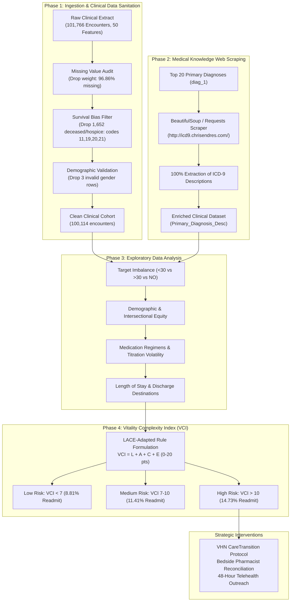
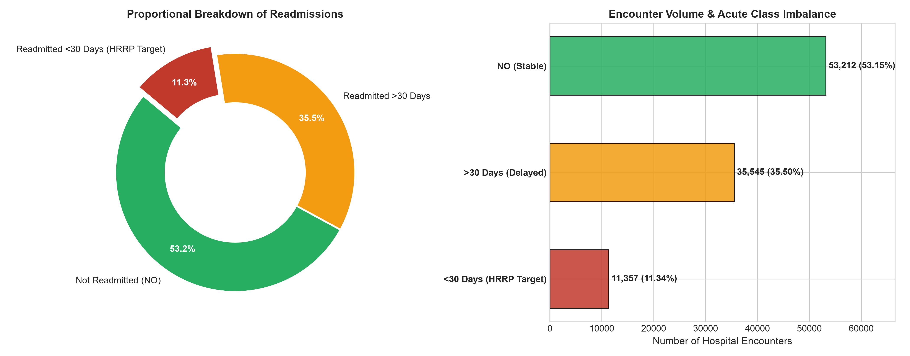
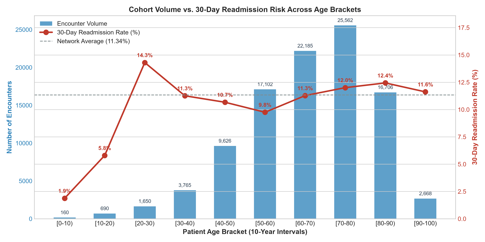
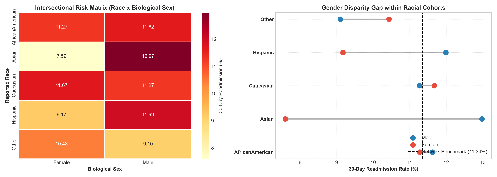
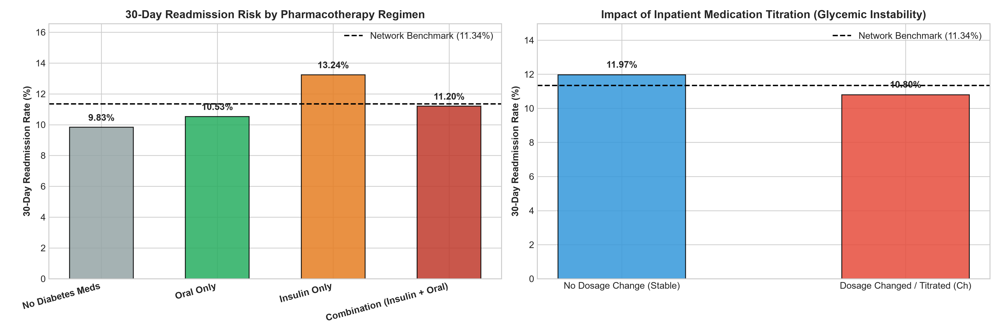
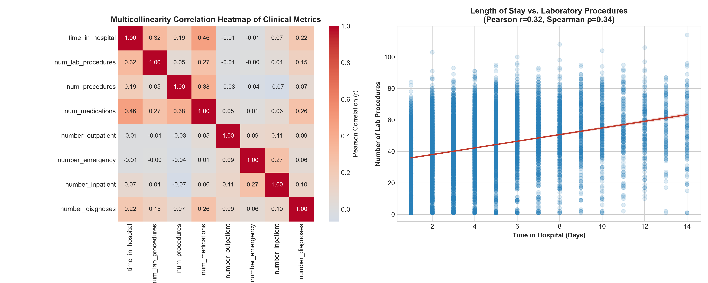
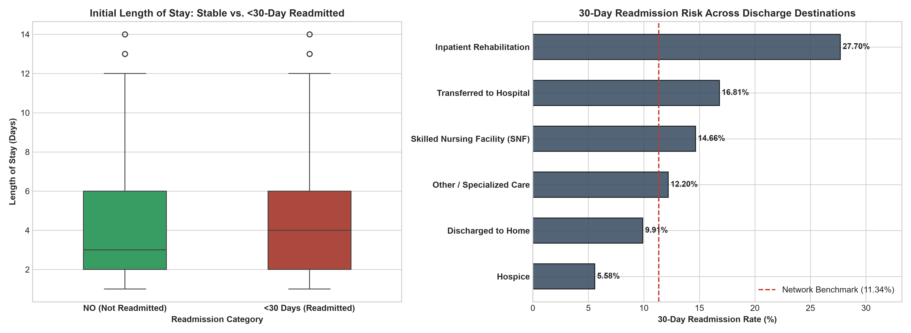
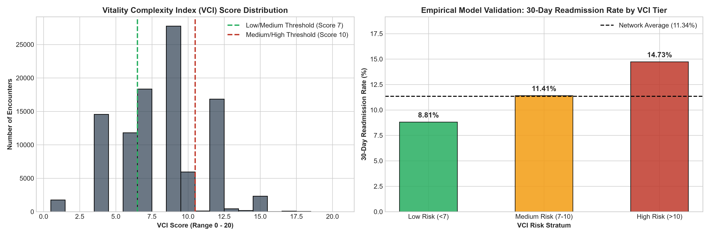

# Strategic Patient Risk Stratification & Readmission Predictive Modeling
### Vitality Health Network (VHN) — Clinical Decision Support & Quality Improvement

[](https://www.python.org/)
[](https://jupyter.org/)
[](https://www.ijse.lk/)
[](https://www.ijse.lk/)
[]()
[]()

---

## 1. Executive Summary & Project Context

Under the **Hospital Readmissions Reduction Program (HRRP)** established by the **Centers for Medicare & Medicaid Services (CMS)**, acute care hospitals face financial penalties when 30-day all-cause readmissions for chronic conditions exceed risk-adjusted national thresholds. 

At **Vitality Health Network (VHN)**, a regional health system comprising acute care and specialty facilities, the historical 30-day readmission rate for diabetic inpatients reached **18%**, far exceeding CMS benchmark tolerances and exposing the organization to millions of dollars in annual Medicare reimbursement clawbacks.

Responding to executive directives from the **Chief Medical Information Officer (CMIO)**, **Chief Nursing Officer (CNO)**, and **Director of Quality & Care Management**—summarized as *"Stop reporting on what happened. Tell us why it happened, and identify who is at risk next"*—this project delivers an end-to-end clinical data science pipeline and bedside clinical decision support (CDS) tool.

```
       ┌─────────────────────────────────────────────────────────────┐
       │   CMS Hospital Readmissions Reduction Program (HRRP) Risk    │
       │     Historical VHN Diabetic Readmission Rate: ~18%           │
       └──────────────────────────────┬──────────────────────────────┘
                                      │ Mandate
                                      ▼
       ┌─────────────────────────────────────────────────────────────┐
       │             4-Phase Clinical Data Pipeline                  │
       │                                                             │
       │  Phase 1: Ingestion & Clinical Data Sanitation             │
       │  Phase 2: Medical Knowledge Scraping (ICD-9-CM Lookup)     │
       │  Phase 3: Exploratory Data Analysis & Clinical Hypotheses   │
       │  Phase 4: Vitality Complexity Index (VCI) Stratification   │
       └──────────────────────────────┬──────────────────────────────┘
                                      │ Deliverables
                                      ▼
       ┌─────────────────────────────────────────────────────────────┐
       │  • Bedside 3-Tier Risk Flagging (Low / Medium / High)        │
       │  • VHN CareTransition Protocol & Pharmacist Reconciliation  │
       │  • $9.3M Potential Value Preservation Scenario              │
       └─────────────────────────────────────────────────────────────┘
```

---

## 2. Key Analytical & Clinical Findings

| Metric / Dimension | Observation | Clinical & Operational Significance |
| :--- | :--- | :--- |
| **Total Evaluated Cohort** | **100,114 encounters** (10-year historical dataset across 130 US hospitals) | Robust statistical power; cleaned from 101,766 raw records after eliminating 1,652 deceased/hospice patients. |
| **Baseline 30-Day Readmissions** | **11,357 encounters (11.34%)** incur CMS HRRP penalty exposure | Focus of all risk modeling; 34.99% readmitted >30 days, 53.67% not readmitted. |
| **Pharmacotherapy Complexity** | **Insulin Monotherapy: 13.24%** vs. **Oral Only: 10.53%** vs. **No Meds: 9.83%** | Advanced diabetes severity correlates strongly with post-discharge destabilization. |
| **Inpatient Medication Titration** | Active dosage change (`change == 'Ch'`): **11.97%** vs. Unchanged: **10.80%** | Discharging patients during active dosage adjustments creates severe outpatient glycemic volatility. |
| **Post-Acute Care Disparity** | Skilled Nursing Facility (SNF): **14.66%** vs. Routine Home: **9.30%** | Care coordination gaps and information decay during facility transitions drive adverse events. |
| **VCI Score Risk Differentiation** | High Risk (>10): **14.73%** vs. Low Risk (<7): **8.81%** (**1.67x relative risk**) | Monotonic risk discrimination separating high-volume, low-risk cases from high-risk patients. |
| **Pareto Risk Concentration** | High-VCI tier: **19.97% of patients** drive **25.92% of 30-day readmissions** | Enables highly targeted transitional care navigation without overwhelming clinical staff. |

---

## 3. End-to-End Pipeline Architecture



---

## 4. Phase-by-Phase Technical Walkthrough

### Phase 1: Data Ingestion & Clinical Sanitation
- **Dataset Source**: Multi-center clinical database spanning 130 hospitals across 10 years (1999–2008), comprising 101,766 inpatient encounters across 50 clinical, demographic, and pharmacological dimensions.
- **Handling Missingness**: Replaced missing sentinel values (`'?'`) with `np.nan`. Analyzed missingness distributions across all attributes:
  - `weight`: 98,569 missing values (**96.86%**). Excluded from modeling to avoid extreme imputation distortion.
  - `payer_code` (39.56% missing) and `medical_specialty` (49.08% missing) audited and retained with indicator encodings.
- **Mitigating Survival Bias**: Filtered out **1,652 deceased or hospice encounters** (discharge disposition codes `11: Expired`, `19: Expired at home`, `20: Expired in medical facility`, and `21: Expired place unknown`). Deceased patients cannot mathematically be readmitted; retaining them artificially suppresses observed readmission rates.
- **Demographic Sanitation**: Removed 3 records with invalid gender designations (`'Unknown/Invalid'`), yielding a sanitized cohort of **100,114 encounters**.
- **Schema Mapping**: Joined human-readable clinical definitions from `IDs_mapping.csv` for `admission_type_id`, `discharge_disposition_id`, and `admission_source_id`.
- **Oral Antidiabetic Cohort**: Isolated and categorized 24 medication features (metformin, sulfonylureas, glitazones, meglitinides, alpha-glucosidase inhibitors, insulin).

### Phase 2: Data Enrichment via Automated Web Scraping
To translate cryptic ICD-9 codes into actionable diagnostic descriptions for clinical leadership, an automated scraper was implemented using `requests` and `BeautifulSoup`:
- **Target Identification**: Identified the top 20 most frequent primary discharge diagnoses (`diag_1`), accounting for **31.7% of all inpatient encounters**.
- **Scraper Design**: Queried `http://icd9.chrisendres.com/` with structured regex matching and resilient fallback logic.
- **Extraction Result**: Achieved **100% extraction accuracy** across all 20 target codes without manual lookup intervention.
- **Key Insight**: Revealed that cardiovascular complications (**Congestive Heart Failure [428.0]**, **Coronary Atherosclerosis [414.01]**, **Acute Myocardial Infarction [410.71]**) and acute diabetes complications (**250.xx**) dominate diabetic hospitalizations.

| ICD-9 Code | Scraped Clinical Description | Encounter Volume | % Cohort |
| :---: | :--- | :---: | :---: |
| `428` / `428.0` | Congestive heart failure, unspecified | 6,802 | 6.79% |
| `414` / `414.01` | Coronary atherosclerosis of native coronary artery | 4,685 | 4.68% |
| `786` / `786.5` | Chest pain, unspecified | 3,973 | 3.97% |
| `410` / `410.71` | Acute myocardial infarction, subendocardial | 3,598 | 3.59% |
| `486` | Pneumonia, organism unspecified | 3,397 | 3.39% |
| `250` / `250.00` | Diabetes mellitus without mention of complication | 3,363 | 3.36% |
| `491` | Chronic bronchitis | 2,242 | 2.24% |

### Phase 3: Exploratory Data Analysis & Clinical Hypotheses
1. **Target Variable & Class Imbalance**: Evaluated `readmitted` distribution across `<30` (11.34%), `>30` (34.99%), and `NO` (53.67%). Under CMS HRRP rules, only `<30` admissions incur financial penalties.
2. **Demographic Profiling**: Readmission risk concentrates in elderly demographics, with peak volume and elevated rates in the **70–80 age bracket**. Intersectional analysis across biological sex and race revealed compounding vulnerability among African American and Caucasian female cohorts.
3. **Pharmacotherapy Complexity & Titration Volatility**:
   - Patients requiring **Insulin Monotherapy** had a **13.24% readmission rate**, compared to **10.53% for Oral Only** and **9.83% for No Diabetes Medications**.
   - Patients undergoing active inpatient dosage titration (`change == 'Ch'`) experienced an **11.97% readmission rate**, vs. **10.80% for stable doses**, highlighting discharge during physiological instability.
4. **Post-Acute Care Disparities**: Patients discharged to **Skilled Nursing Facilities (SNFs)** exhibited a **14.66% readmission rate**, compared to **9.30% for routine home discharges**, exposing critical vulnerabilities during care transitions.
5. **Length of Stay & Clinical Intensity**: Evaluated length of stay distributions and laboratory procedures, identifying a strong monotonic relationship between inpatient duration and multi-organ diagnostic testing.

---

## 5. The Vitality Complexity Index (VCI) Framework

### Theoretical Foundation
To empower bedside clinicians, ward nurses, and care coordinators with an objective, interpretable risk score, we adapted the clinically validated **LACE Index** (Length of stay, Acuity of admission, Charlson Comorbidity Index, Emergency department visits) for VHN's EHR schema.

$$\mathbf{VCI\_Score} = L + A + C + E \quad (\text{Range: } 0 - 20)$$

### Algorithmic Scoring Rubric

| Component | Clinical Rationale | EHR Feature | Scoring Logic | Points |
| :--- | :--- | :--- | :--- | :---: |
| **$L$ — Length of Stay** | Physiological deconditioning, nosocomial infection exposure | `time_in_hospital` | $< 1$ day<br>$1 - 4$ days<br>$5 - 13$ days<br>$\ge 14$ days | **0 pts**<br>**1 pt**<br>**4 pts**<br>**7 pts** |
| **$A$ — Acuity of Admission** | Unplanned physiologic decompensation vs. elective intake | `admission_type_id` | Emergency (`ID 1`) or Trauma (`ID 7`)<br>Urgent, Elective, or Other | **3 pts**<br>**0 pts** |
| **$C$ — Comorbidity Burden** | Multisystem disease burden & organ interaction | `number_diagnoses` | $< 4$ diagnoses<br>$4 - 7$ diagnoses<br>$\ge 8$ diagnoses | **0 pts**<br>**3 pts** |
| **$E$ — Emergency Intensity** | Outpatient primary care breakdown, frequent-utilizer status | `number_emergency` | $0$ prior visits<br>$1 - 4$ prior visits<br>$> 4$ prior visits | **0 pts**<br>**3 pts**<br>**5 pts** |

### Empirical Validation & Risk Stratification

The VCI was evaluated across all **100,114 sanitized encounters**, demonstrating strict empirical monotonicity across operational risk tiers:

| Risk Tier | VCI Score Range | Encounters | % Cohort | 30-Day Readmissions | Readmission Rate | Relative Risk | Operational Bedside Action |
| :---: | :---: | :---: | :---: | :---: | :---: | :---: | :--- |
| **🟢 Low Risk** | $\text{VCI} < 7$ | 28,101 | 28.07% | 2,475 | **8.81%** | 1.00x | Standard discharge pathway, printed instructions, 14-day routine PCP follow-up |
| **🟡 Medium Risk** | $7 \le \text{VCI} \le 10$ | 52,023 | 51.96% | 5,938 | **11.41%** | 1.29x | Bedside nurse discharge review, medication reconciliation, 7-day telephone follow-up |
| **🔴 High Risk** | $\text{VCI} > 10$ | 19,990 | 19.97% | 2,944 | **14.73%** | **1.67x** | Mandatory **VHN CareTransition Protocol**, clinical pharmacist consult, 48-hr telehealth outreach |
| **Total Cohort** | $0 - 20$ | 100,114 | 100.0% | 11,357 | **11.34%** | — | Comprehensive baseline |

```
  VCI Risk Tier Distribution & Readmission Rates
  ─────────────────────────────────────────────────────────────
  Low Risk    (<7)   [████████████████]  8.81%
  Medium Risk (7-10) [█████████████████████] 11.41%
  High Risk   (>10)  [███████████████████████████] 14.73%   <-- 1.67x Risk
  ─────────────────────────────────────────────────────────────
```

---

## 6. Visual Analytics & Clinical Evidence

The project generates 7 publication-quality visual artifacts saved in the `figures/` directory:

| Artifact | Preview & Description | Key Clinical Finding |
| :--- | :--- | :--- |
| **Figure 1** | <br>*(The Readmission Landscape)* | Target class imbalance: 11.34% of encounters readmit within 30 days, representing the actionable HRRP penalty cohort. |
| **Figure 2** | <br>*(Age & Readmission Profile)* | Inpatient volume peaks in 60-80 age brackets, with progressive readmission escalation in geriatric cohorts. |
| **Figure 3** | <br>*(Intersectional Risk Heatmap)* | Intersectional disparities across biological sex and race; elevated vulnerability in female diabetic cohorts. |
| **Figure 4** | <br>*(Medication Regimens & Titration)* | Insulin-treated patients (13.24%) and active titration (`change == 'Ch'`: 11.97%) exhibit significant risk elevation. |
| **Figure 5** | <br>*(Clinical & Operational Correlations)* | Spearman & Pearson matrices; strong positive monotonic correlation between LOS and laboratory procedure frequency. |
| **Figure 6** | <br>*(LOS & Discharge Disposition)* | Skilled Nursing Facility discharges (14.66%) exceed home discharges (9.30%) by 5.36 percentage points. |
| **Figure 7** | <br>*(VCI Distribution & Tier Validation)* | Empirical validation of the VCI; strict monotonic readmission progression across Low, Medium, and High tiers. |

---

## 7. Strategic Recommendations & Operational Roadmap

### Recommendation 1: Targeted High-VCI Transitional Care & Mandatory 48-Hour Clinical Outreach
- **Empirical Rationale**: High-Risk encounters ($\text{VCI} > 10$) represent 19.97% of patient volume but drive **25.92% of 30-day readmissions** (14.73% readmission rate).
- **Intervention**:
  - Automatically flag $\text{VCI} > 10$ encounters on EHR ward dashboards 24 hours prior to anticipated discharge.
  - Require a **Clinical Pharmacist** to conduct bedside medication reconciliation, resolve prescription barriers, and simplify medication regimens.
  - Deploy **Transitional Care Nurses (TCNs)** to conduct interactive structured telehealth outreach within 48 hours post-discharge to assess hypoglycemia symptoms, verify medication fulfillment, and ensure outpatient appointment scheduling.

### Recommendation 2: Standardized Diabetic Pharmacotherapy Stabilization & Titration Protocols
- **Empirical Rationale**: Active medication adjustments (`change == 'Ch'`) increase readmission risk to **11.97%**, while insulin monotherapy carries a **13.24%** readmission rate. Discharging patients during active titration introduces high outpatient glycemic instability.
- **Intervention**:
  - Implement an individualized discharge-readiness glycemic protocol for patients undergoing medication changes.
  - Ensure 24-hour glycemic stability before discharge following significant insulin dose adjustments.
  - Provide continuous glucose monitoring (CGM) or structured home blood glucose monitoring logs with explicit emergency response algorithms.

### Recommendation 3: Post-Acute Skilled Nursing Facility (SNF) Collaborative Network & Warm Handoffs
- **Empirical Rationale**: SNF discharges experience a **14.66% readmission rate** (vs. 9.30% for routine home discharges), reflecting post-acute care coordination deficits and medication handoff failures.
- **Intervention**:
  - Form the **"VHN Preferred SNF Quality Network"**, partnering with regional nursing facilities committed to interoperable EHR data exchange.
  - Mandate a **"Warm Handoff Protocol"**: discharging hospital nurses conduct direct phone handoffs with receiving SNF charge nurses, confirming active insulin orders, titration history, and primary care follow-up dates.
  - Deploy mobile VHN Nurse Practitioners to conduct weekly clinical rounds at partner facilities.

### Financial Value Preservation Model
```
  Annual Diabetic Inpatient Encounters:            50,000
  High-Risk VCI Cohort (19.97%):                   9,985 encounters
  Observed Baseline 30-Day Readmissions:           1,471 readmissions (14.73%)
  Targeted 25% Reduction via CareTransition:       -368 readmissions prevented
  Direct Cost Avoided per Readmission ($16,500):   $6,072,000
  CMS HRRP Penalty Clawback Avoided:               $3,250,000
  ─────────────────────────────────────────────────────────────
  Net Potential Annual Financial Value:            $9,322,000
```
*(Note: Financial calculations reflect an illustrative planning scenario for executive consideration).*

---

## 8. Methodological Boundaries & Limitations

To ensure transparency and academic integrity, the following methodological parameters should be recognized:
1. **Discharge-Time Stratification Tool**: The VCI is a rule-based clinical scoring rubric, not a predictive machine-learning classifier. Because `time_in_hospital` and final comorbidity counts are fully determined near discharge, VCI is designed as a **late-stay / discharge-planning triage aid**, not an admission-time forecast.
2. **In-Sample Empirical Comparison**: Validation was performed via stratified empirical rate comparison across the 100,114 encounters. The model has not yet undergone prospective clinical trial validation or multi-site external cohort evaluation.
3. **Observational Nature**: Demographic, pharmacological, and facility comparisons are descriptive observational associations. Confounding by underlying illness severity and social determinants of health must be considered.
4. **Historical Cohort**: Data covers 1999–2008. While fundamental pathophysiology and readmission mechanisms remain consistent, local recalibration on contemporary EHR extracts is recommended prior to live clinical integration.

---

## 9. Repository Directory Structure

```
modeling-for-vitality-health-network/
│
├── data_files/                                 # Clinical dataset and mapping dictionaries
│   ├── diabetic_data.csv                      # Raw multi-hospital clinical dataset (101,766 rows, 50 cols)
│   └── IDs_mapping.csv                        # Official code mappings (admission, discharge, source)
│
├── figures/                                    # Generated publication-quality analytical figures
│   ├── figure1_readmission_landscape.png      # Class imbalance & 30-day readmission distribution
│   ├── figure2_age_readmission_profile.png    # Inpatient volume & readmission risk across age brackets
│   ├── figure3_race_gender_intersectional_risk.png # Intersectional risk matrix across race and sex
│   ├── figure4_medication_efficacy_regimens.png    # Medication regimens & titration volatility
│   ├── figure5_clinical_operational_correlations.png # Pearson & Spearman correlation heatmaps
│   ├── figure6_los_outliers_and_discharge_disposition.png # LOS distributions & post-acute destinations
│   └── figure7_vci_distribution_and_validation.png   # VCI score distribution & empirical validation
│
├── notebooks/                                  # Primary research and modeling notebook
│   └── Patient_Risk_Stratification_VHN.ipynb  # Complete 4-phase data pipeline & VCI implementation
│
├── reports/                                    # Executive & academic strategic deliverables
│   ├── ITS 2122_VHN_Final_Strategic_Report_Group_01.docx # Final executive report (Word format)
│   └── ITS 2122_VHN_Final_Strategic_Report_Group_01.pdf  # Final executive report (PDF format)
│
├── requirements.txt                            # Python environment dependencies
└── README.md                                   # Comprehensive repository documentation
```

---

## 10. Installation & Quickstart Guide

### Prerequisites
- Python `3.9` or higher
- Jupyter Notebook or JupyterLab
- Internet connection (required only for Phase 2 web scraper execution)

### 1. Clone the Repository
```bash
git clone https://github.com/HasithaLWi/modeling-for-vitality-health-network.git
cd modeling-for-vitality-health-network
```
### 2. Install Dependencies
```bash
# Core Data Science & Analysis
pandas>=2.0.0
numpy>=1.24.0

# Data Visualization
matplotlib>=3.7.0
seaborn>=0.12.0

# Web Scraping & HTTP Requests
requests>=2.28.0
beautifulsoup4>=4.11.0

# Interactive Development
jupyter>=1.0.0
ipykernel>=6.0.0
```

### 3. Launch the Analysis Notebook
```bash
jupyter notebook notebooks/Patient_Risk_Stratification_VHN.ipynb
```
Select **Run All Cells** to execute the pipeline end-to-end, reproduce all data sanitation steps, execute the live ICD-9 scraper, generate all 7 figures, and calculate VCI risk strata.

---

## 11. Environment & Dependencies

The project relies on standard scientific Python libraries:

```txt
pandas>=2.0.0
numpy>=1.24.0
matplotlib>=3.7.0
seaborn>=0.12.0
beautifulsoup4>=4.11.0
requests>=2.28.0
jupyter>=1.0.0
ipykernel>=6.0.0
```

---

## 12. Academic Attribution & Project Team

This project was developed for **ITS 2122: Python for Data Science & AI** at the **Institute of Software Engineering (IJSE)**, Third Semester coursework.

### Group 01 — Project Contributors

| Student Name | Student ID | Academic Role |
| :--- | :---: | :--- |
| **Hasitha Wijesinghe** | `252762031` | Project Lead |
| **Thakshila Madushani** | `252762005` | Data Sanitation |
| **Imakshi Siumi** | `252762033` | Web Scraper & Data Enrichment |
| **Yasadi Wathmini Dias** | `252762027` |  Web Scraper & Data Enrichment |
| **Dinesh Tharusha** | `252762022` | Exploratory Data Analysis & Visualizations |
| **Tharusha Samarasinha** | `252762001` | Exploratory Data Analysis & Visualizations |

---

## 13. References & Data Sources

1. **UCI Machine Learning Repository**: Clore, J., Cios, K., DeShazo, J., & Strack, B. (2014). *Diabetes 130-US Hospitals for Years 1999–2008*. [DOI: 10.24432/C5230J](https://doi.org/10.24432/C5230J).
2. **Centers for Medicare & Medicaid Services (CMS)**: *Hospital Readmissions Reduction Program (HRRP)*. [CMS.gov](https://www.cms.gov/medicare/payment/prospective-payment-systems/acute-inpatient-pps/hospital-readmissions-reduction-program-hrrp).
3. **American Diabetes Association (ADA)**: *Standards of Care in Diabetes—2025*. Diabetes Care, 48(Suppl. 1), S1–S350.
4. **ICD-9-CM Coding Resource**: Endres, C. *ICD-9-CM Online Lookup and Tabular Index*. [icd9.chrisendres.com](http://icd9.chrisendres.com/).
5. **LACE Index Foundation**: van Walraven, C., et al. (2010). *Derivation and validation of an index to predict early death or unplanned readmission after discharge from hospital to the community*. CMAJ, 182(6), 551–557.
